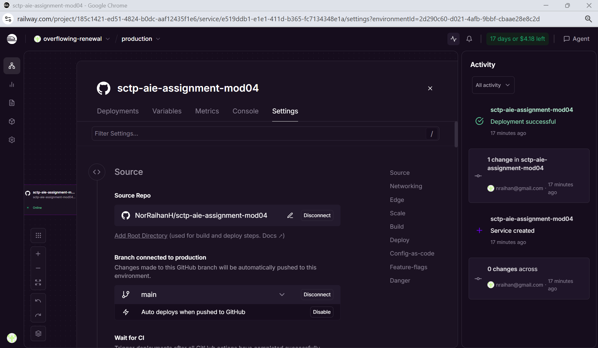
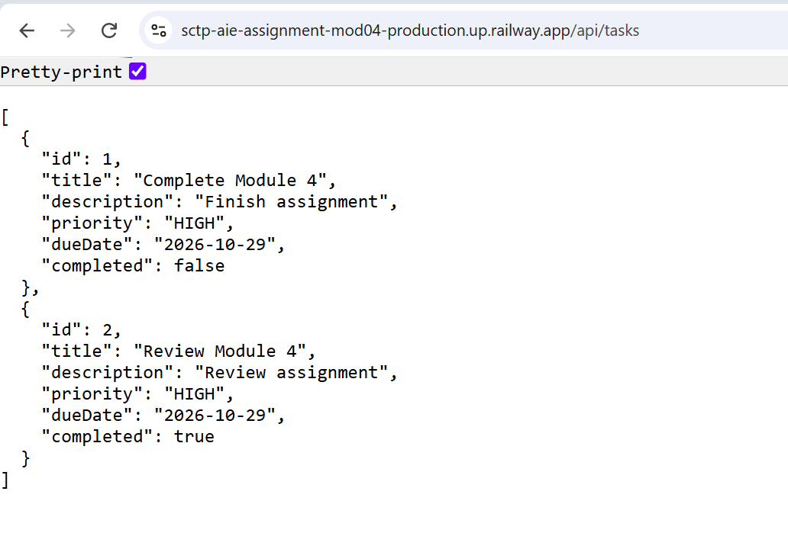

# TaskFlow API — Module 4: Dockerize & Deploy

This project is part of the **NTU SCTP Advanced Professional Certificate in AI Engineering — Module 4 DevOps** assignment.

It extends the TaskFlow REST API developed in Module 3 by packaging it as a Docker image and deploying it to Railway.

## Live Application

**Task API:** https://sctp-aie-assignment-mod04-production.up.railway.app/api/tasks

**GitHub repository:** https://github.com/NorRaihanH/sctp-aie-assignment-mod04

The application is a backend API, so the task endpoint returns JSON rather than a web page.

## Assignment Status

The baseline assignment is complete: the application has been containerised and deployed to Railway, and the deployed task endpoint has been verified.

| Task | Status |
|---|---|
| Create a multi-stage Dockerfile | Completed |
| Build and test the Docker image locally | Completed |
| Push the project to GitHub | Completed |
| Deploy the application to Railway | Completed |
| Verify the live API and capture deployment screenshots | Completed |

## Technology Stack

| Component | Technology |
|---|---|
| Language | Java 21 |
| Application framework | Spring Boot 4.1.1 |
| REST API | Spring Web MVC |
| Data access | Spring Data JPA / Hibernate |
| Database | H2 in-memory database |
| Build tool | Maven |
| Containerisation | Docker with a multi-stage build |
| Source-code hosting | GitHub |
| Application hosting | Railway |

## Docker Configuration

The Dockerfile uses two stages:

1. **Build stage:** Maven and JDK 21 compile and package the application inside Docker. A locally generated `target/` directory is not required.
2. **Runtime stage:** Only the packaged JAR is copied into a Java 21 JRE image. Maven and the source code from the build stage are not copied into the final image.

```dockerfile
# Stage 1: Build the JAR with Maven
FROM maven:3.9-eclipse-temurin-21 AS build
WORKDIR /app
COPY . .
RUN mvn clean package -DskipTests

# Stage 2: Run the JAR in a slim runtime image
FROM eclipse-temurin:21-jre-alpine
WORKDIR /app
COPY --from=build /app/target/*.jar app.jar
EXPOSE 8080
CMD ["java", "-jar", "app.jar"]
```

`CMD` defines the default application startup command. `EXPOSE 8080` documents the application port; the local `-p` option and Railway networking configuration make that port accessible.

The Docker build currently skips test execution with `-DskipTests`. A successful image build is therefore not evidence that automated tests have passed.

## Build and Run Locally

### Prerequisites

- Git
- Docker installed and running

Java and Maven do not need to be installed locally for this Docker-based build.

### Clone the repository

```bash
git clone https://github.com/NorRaihanH/sctp-aie-assignment-mod04.git
cd sctp-aie-assignment-mod04
```

### Build the image

```bash
docker build -t taskflow:latest .
```

### Start the container

```bash
docker run --name taskflow -p 8080:8080 taskflow:latest
```

Open another terminal and test the API:

```bash
curl http://localhost:8080/api/tasks
```

On Windows PowerShell, use `curl.exe` if `curl` resolves to a PowerShell alias.

To stop and remove the local container:

```bash
docker stop taskflow
docker rm taskflow
```

## Railway Deployment

The baseline deployment uses the GitHub repository as the source for Railway. Railway builds the application using the root Dockerfile and runs the resulting container.

Deployment steps:

1. Push the application source and Dockerfile to GitHub.
2. Create a Railway project and select the GitHub repository.
3. Deploy the service using the Dockerfile.
4. Generate a public domain and configure its target port as `8080`.
5. Verify the deployed `/api/tasks` endpoint.

### Active deployment



### Live API verification

The following screenshot shows the deployed API returning task data as JSON.



To call the deployed endpoint:

```bash
curl https://sctp-aie-assignment-mod04-production.up.railway.app/api/tasks
```

An empty JSON array (`[]`) is also a valid response when no tasks exist.

## API Endpoints

| Method | Endpoint | Description | Successful response |
|---|---|---|---|
| GET | `/api/tasks` | Retrieve all tasks | `200 OK` |
| GET | `/api/tasks/{id}` | Retrieve a task by ID | `200 OK` |
| POST | `/api/tasks` | Create a task | `201 Created` |

A lookup for a task ID that does not exist returns `404 Not Found`.

### Create a task

Send a `POST` request to the live `/api/tasks` endpoint using Postman, with `Content-Type: application/json` and this raw JSON body:

```json
{
  "title": "Complete Module 4",
  "description": "Finish assignment",
  "priority": "HIGH",
  "dueDate": "2026-10-29",
  "completed": false
}
```

The API returns the created task with its generated `id`. Use that returned ID when testing `GET /api/tasks/{id}`.

## Data Persistence and Limitations

The application uses the H2 in-memory database configured in `src/main/resources/application.properties`:

```properties
spring.datasource.url=jdbc:h2:mem:taskflowdb
```

Task data is temporary and is lost when the application process restarts, including during a redeployment. The records shown in the screenshot may therefore differ from the current live response. No external persistent database is configured for this baseline.

## Stretch Goals

**Planned:** Implement a CircleCI pipeline connected to GitHub to build, test, and publish the application image to Docker Hub.

CircleCI integration and Docker Hub publication are not part of the completed baseline documented here. Pipeline links, image links, and results will be added after implementation.

## Errors and Troubleshooting

The baseline deployment is complete. No specific error history is recorded in this README. Any subsequent deployment or pipeline failures and their resolutions will be documented as the project progresses.

## Author

**Raihan**  
NTU SCTP Advanced Professional Certificate in AI Engineering  
Module 4 — DevOps
